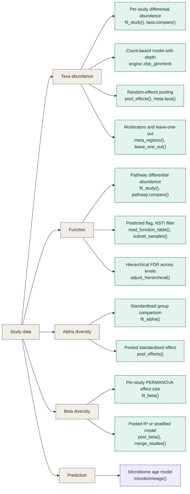

# metamicrobiomeR

**Meta-analysis for microbiome studies that do not share a platform, a pipeline or a database.**
Analyse each study on its own terms and **pool the results across studies**, with checks for when pooling would mislead.
It complements a combined analysis of merged tables rather than replacing it: it still works when the tables cannot be
merged, and it shows how much the studies disagree (see `vignette("cross-platform")` and `dev/POSITIONING.md`).
The zero-inflated beta model follows Ho et al. (2019), *BMC Bioinformatics* 20:188,
<https://doi.org/10.1186/s12859-019-2744-2>.

> **Status: version 2.0 is a pre-release and is not on CRAN.** The API may still change.

## If you used version 1.x

Your scripts keep working. `taxa.compare()`, `meta.taxa()`, `metatab.show()`, `meta.niceplot()` and the other 1.x functions are all here, with the same
arguments and output, and `vignette("my-vignette")` is the original tutorial. See `NEWS.md` for the few changes that can alter results, and
`vignette("migrating-from-1x")` when you want to move a table to the new functions with `legacy_to_study()`.

## The short way

Try it with the built-in simulated example (`?example_studies`), then use your own studies:

```r
res <- meta_analyse(example_studies, ~ group + age, term = "groupcase", rank = "genus", engine = "lm_asin",
                    fit_args = list(longitudinal = FALSE))
res
```

```r
library(metamicrobiomeR)

studies <- list(study1, study2, study3)            # mm_study objects: see "Getting your data in" below
res <- meta_analyse(studies, ~ group + age, term = "groupb", rank = "genus")
res                                                 # summary: studies, engine, features pooled, top results
plot(res)                                           # forest plots of the strongest features (also "heatmap", "volcano")
as.data.frame(res)                                  # the pooled table
```

Add `alpha = TRUE` and `beta = TRUE` for alpha and beta diversity with the same model, and `write_report(res)` for a
shareable Markdown report with figures. `meta_analyse()` checks that the studies can be pooled, matches taxa across databases by name, fits the same model to every
study, flags implausible estimates, and pools. Messages and warnings are labelled with the study they come from.
Everything it did is kept in `res$effects`, `res$studies`, `res$checks` and `res$quality`.

## Step by step (full control)

```r
# 1. studies: counts or proportions, taxonomy in rank columns, study metadata
study <- read_dada2(seqtab, taxa, samples, list(id = "cohort1", region = "V4", database = "SILVA 138"))
genus <- agglomerate(study, "genus")

# 2. one model per feature -> effect table (cores = 4 fits the features in parallel on Linux/macOS)
eff <- fit_study(genus, ~ group + age, engine = "zibb_glmmtmb")

# 3. check, then pool across studies
bound <- bind_effects(eff1, eff2, eff3)             # refuses to mix engines or scales
check_effects_quality(bound)                        # an implausibly small standard error gives one study all the weight
pooled <- pool_effects(bound, term = "groupb")      # REML + ad hoc Hartung-Knapp, FDR within rank
pool_sensitivity(bound, term = "groupb")            # does the answer depend on the test?

# 4. look, check influence, report
plot_forest(bound, pooled, feature = "g__Blautia", term = "groupb")
leave_one_out(bound, feature = "g__Blautia", term = "groupb")
write_manifest(genus, "cohort1-manifest.txt")
```

## Graphs

All graphs are `ggplot2` objects in one style, so you can adjust them with `+ theme(...)`, `+ labs(...)` and so on. From the result of
`meta_analyse()`, `plot(res, type)` draws:

| `type` | Shows | Notes |
|---|---|---|
| `"forest"` (default) | each study and the pooled effect, with the prediction interval, for the strongest features | `top = 3`, or `feature = "Blautia"` |
| `"heatmap"` | studies by features, with a pooled column and significance stars | `top = 25` |
| `"volcano"` | pooled estimate against evidence, for all features | extreme estimates are drawn at the edge |
| `"alpha"` | forest plot of the alpha-diversity metrics | needs `alpha = TRUE` |
| `"beta"` | PERMANOVA R2 of each study and the combined result | needs `beta = TRUE` |
| `"influence"` | the pooled effect with each study left out in turn | shows whether one study drives a result |

With several terms in the model, choose one with `term = "groupcase"`. The functions behind them (`plot_forest()`, `plot_heatmap()`,
`plot_volcano()`) take effect tables from the step-by-step workflow.

## Getting your data in

`read_dada2()`, `read_qiime2()`, `read_metaphlan()`, `read_biom_study()`, `study_from_phyloseq()`,
`study_from_se()` (SummarizedExperiment / TreeSummarizedExperiment), or `as_study()` from plain matrices.

**From QIIME 2:** `read_qiime2(table, taxonomy, metadata, study)` takes the feature table, the taxonomy and the usual tab-separated
metadata file, either as the native artifacts (`.qza`; the feature-table artifact needs `biomformat` and `rhdf5`) or as exported text files.
The `#q2:types` row of the metadata decides which columns are numbers and which are categories, and samples that are in only one of the table and
the metadata (controls, for example) are left out, with a message saying which. A small simulated example in QIIME 2's layout is in
`system.file("extdata", "qiime2-example", package = "metamicrobiomeR")`; see the vignette.

If you already read your QIIME 2 files into phyloseq, for example with the `qiime2R` package (`qiime2R::qza_to_phyloseq()`), use
`study_from_phyloseq(ps, study)`: it gives the same study as `read_qiime2()`. That is tested with a phyloseq object shaped like `qiime2R`'s output;
`qiime2R` itself is a separate package (not on CRAN) that is not run in the tests.

Results from other tools (MaAsLin2, ANCOM-BC2, LinDA) can be pooled too: `effects_from()`.

## How much do the studies differ, and why?

A meta-analysis shows how much the evidence differs between studies, which is often the most useful result.
`summary(res)` reports the between-study variation (I2, tau2, the heterogeneity test), whether a pooled effect would
hold in a new study (prediction intervals), the most heterogeneous features, and what can explain the differences:
study characteristics (`meta_regress()`), one influential study (`leave_one_out()`), or batch effects within studies.

Batch effects show up in a meta-analysis only when they matter for the group comparison. In a simulation (mock data,
5 studies, 6 truly different features; one run, simple per-feature multiplicative batch effects):

| Batch effect planted | Median I2 | Features with significant heterogeneity |
|---|---|---|
| None | 4% | 8% |
| Same distortion for every sample of a study | 0% | 10% |
| Distortion on one group only, in 3 of 5 studies | 43% | 44% |

A shift that affects every sample of a study equally cancels in the within-study comparison, so it does not bias the
pooled effect and does not raise I2. A batch effect that differs between the groups does bias the effect, and the
heterogeneity is the warning. Heterogeneity does not say *why*: batch, population and protocol differences look alike,
and with a handful of studies I2 is imprecise.

What to do about it: for batches *within* a study (plates, runs), add the batch as a covariate (`~ group + batch`) in
`fit_study()`. To estimate or correct batch effects in the abundance data, use a dedicated package (for example
ComBat-seq or MMUPHin, as far as we know the main ones), then re-run. This package does not correct batch effects: it
does not remove them from the data, and data corrected elsewhere is tested as if it were raw, which makes p-values
over-confident. Adjusting with a covariate in the model is preferred.

## Scope: what this package is and is not

It is the **meta-analysis layer for microbiome studies**: it takes per-study abundance tables, fits comparable
models, and pools them with the checks that matter when there are only a few studies. It is not a complete
microbiome analysis environment, and does not try to be.

| | |
|---|---|
| **Covered** | Import from common formats; taxonomy harmonisation by name across databases; per-study differential abundance (four engines) and alpha and beta diversity; random-effects pooling, meta-regression, leave-one-out, hierarchical FDR; p-value combination; one-stage analysis of merged studies; checks before and after pooling; forest, heatmap and volcano plots; a reproducibility manifest; simulation |
| **Bring your own** | Preprocessing (DADA2, QIIME 2, MetaPhlAn), descriptive plots and ordination (phyloseq, mia, vegan), other differential-abundance methods (pool their output with `effects_from()`) |
| **Not covered** | Batch-effect correction across studies; a compositional-bias-corrected estimator of its own (a CLR model is offered as a sensitivity analysis, and a pilot benchmark showed it does not control false positives when many features differ); network and co-occurrence analysis; strain-level analysis; publication-bias methods (they need many more studies than microbiome meta-analyses usually have); random slopes and other longitudinal structure beyond a subject intercept |

Evidence so far: a pilot simulation compares the engines (`dev/BENCHMARK-PILOT.md`) and a cross-platform simulation
compares two-stage and combined analyses (`dev/BENCHMARK-CROSSPLATFORM.md`). Neither is a substitute for peer review
or a full benchmark.

Functions say what they decided or left out (for example "6 of 40 samples have missing values and are left
out") and stay quiet otherwise; `options(metamicrobiomeR.quiet = TRUE)` silences the messages, not the warnings.

See `vignette("getting-started")` and `vignette("cross-platform")` for runnable examples.

## What you can analyse

Start from your study data and follow a branch. Teal boxes are in the new workflow; purple is only in the original 1.x functions, which are still available.



<details>
<summary>The same tree as plain text</summary>

```text
Study data
├── Taxa abundance
│   ├── Per-study differential abundance   fit_study(), taxa.compare()
│   ├── Count-based model with depth       engine zibb_glmmtmb
│   ├── Random-effects pooling             pool_effects(), meta.taxa()
│   └── Moderators and leave-one-out       meta_regress(), leave_one_out()
├── Function
│   ├── Pathway differential abundance     fit_study(), pathway.compare()
│   ├── Predicted flag, NSTI filter        read_function_table(), subset_samples()
│   └── Hierarchical FDR across levels     adjust_hierarchical()
├── Alpha diversity
│   ├── Standardised group comparison      fit_alpha()
│   └── Pooled standardised effect         pool_effects()
├── Beta diversity
│   ├── Per-study PERMANOVA effect size    fit_beta()
│   └── Pooled R² or stratified model      pool_beta(), merge_studies()
└── Prediction
    └── Microbiome age model               microbiomeage()   (original 1.x only)
```

</details>

Three details that the boxes cannot show:

- `pool_beta()` combines the studies' permutation p-values (Stouffer or Fisher) and reports a sample-size-weighted mean R² only as a description. For a model with a study term, merge the studies with `merge_studies()` and fit `fit_beta()` on the result.
- There is no function for the NSTI filter: `read_function_table()` records whether the functions were measured or predicted, and you filter on an `nsti` column of the sample data with `subset_samples()`.
- `adjust_hierarchical()` works on any parent-child structure of features (see `feature_parents()`), including taxonomic ranks, so it also applies to the taxa branch.

## What is in the package

| Area | Functions |
|---|---|
| Studies | `as_study()`, `check_study()`, `subset_samples()`, `subset_features()`, `study_table()`, `agglomerate()` |
| Import | `read_dada2()`, `read_qiime2()`, `read_metaphlan()`, `read_biom_study()`, `study_from_phyloseq()`, `study_from_se()`, `read_function_table()`; export with `as_phyloseq()`, `as_summarized_experiment()` |
| Taxonomy | `parse_taxonomy()`, `harmonise_names()`, `feature_parents()` |
| Per-study models | `fit_study()` with engines `zibb_glmmtmb` (counts, uses depth, optional prevalence part), `bezi_gamlss` (the GAMLSS-BEZI model of Ho et al. 2019), `lm_asin`, `lm_clr`; `fit_alpha()`, `fit_beta()` |
| Before pooling | `check_poolable()`, `feature_coverage()`, `check_effects_quality()`, `filter_effects()` |
| Pooling | `bind_effects()`, `pool_effects()`, `leave_one_out()`, `pool_sensitivity()`, `meta_regress()`, `combine_pvalues()`, `merge_studies()` (one-stage), `pool_beta()`, `adjust_hierarchical()` |
| Other tools' results | `effects_from()` (MaAsLin2, ANCOM-BC2, LinDA, generic) |
| Output | `plot_forest()`, `plot_heatmap()`, `plot_volcano()`, `manifest()`, `write_manifest()` |
| Simulation | `simulate_study()`, `simulate_studies()` |

The two data contracts (the study object and the effect table) are specified in
[`dev/SPEC.md`](dev/SPEC.md).
The source is organised by workflow stage (numbered files in `R/`, with matching numbered tests); see
[`dev/STRUCTURE.md`](dev/STRUCTURE.md).

## Install

Version 2.0 is planned for CRAN in December 2026. Until then, install it from GitHub (needs the `remotes` package):

```r
remotes::install_github("nhanhocu/metamicrobiomeR@dev-2.0")
```

Older versions stay available by tag: `remotes::install_github("nhanhocu/metamicrobiomeR@v1.2")` for CRAN 1.2, and
`@v1.1-github` for the earlier GitHub version.

The packages for the 1.x functions and the GAMLSS model (`dplyr`, `gamlss`, `ggplot2`, `lme4`, `meta` and a few others) are
installed with the package. Everything else is optional, and a function that needs a package says which one and how to
install it:

| Package | Needed for |
|---|---|
| `glmmTMB` | the count model (`engine = "zibb_glmmtmb"`, the `"auto"` choice when every study has counts) |
| `vegan` | beta diversity |
| `metafor` | the pooling estimators EB, ML, HE and SJ (REML, DL and Paule-Mandel need nothing) |
| `phyloseq`, `SummarizedExperiment`, `biomformat` | the matching importers |

## Benchmarks

* [`dev/BENCHMARK-PILOT.md`](dev/BENCHMARK-PILOT.md): a small pilot benchmark of the engines on
  simulated data (preliminary).
* [`dev/BENCHMARK-CROSSPLATFORM.md`](dev/BENCHMARK-CROSSPLATFORM.md): two-stage meta-analysis against a combined analysis
  on simulated studies from different platforms (preliminary).

## Authors and licence

Nhan Ho (author), Payton Yau (maintainer). GPL-3.

## Citation

If you use metamicrobiomeR, please cite the package and the paper describing the zero-inflated beta model:
`citation("metamicrobiomeR")` gives both.
